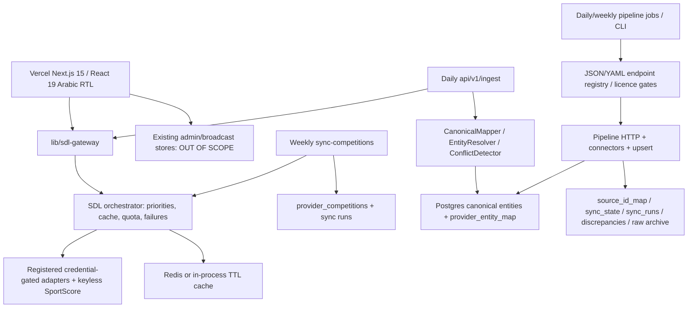

# Architecture before implementation — 2026-10-13

## Scope and verification boundary
Inspected checkout 2b89637 on arena/9d8e64d8-sport before modifying application code: SDL adapters/orchestrator/stores, SQL schema and migrations 2–6, gateway, competition sync, pipeline registry/connectors/runner/upserts, API routes, frontend detail/list pages, sitemap/robots, Vercel cron and CI. No credentials (provider, Postgres, Redis, cron) are present in this sandbox. Outbound access is restricted to GitHub/npm/PyPI, **not provider hosts or nemo-sports.vercel.app**. Thus new live payload verification and production scheduler/dashboard verification are blocked. Existing audits contain captured SportScore evidence, not new verification. No count from mocks may be called a real discovery count.

## Existing architecture

## Tables, identities, persistence
- schema.sql: sports, countries, competitions, seasons, venues, teams, players, matches, match_events, match_stats, standings, top_scorers, provider_entity_map and associated administrative/provider-health tables. UUID PKs; competition->sport/country/current season; season->competition; match->competition/season/teams/venue. Season unique (competition,slug), one current season; provider map unique entity/provider/provider-id. Scores nullable, FK and status checks.
- Migrations 2–5 add news/admin/durable/moderation storage, including provider_competitions (unique provider/provider_id) and catalog run history. Migration 6 adds pipeline source mappings, checkpoints/runs, raw archive and discrepancies.
- SDL CanonicalMapper resolves IDs via mapping first, then deterministic canonicalId; EntityResolver may propose cross-source matches with confidence/review. Pipeline lookup checks source_id_map then provider_entity_map and writes both transactionally. Existing slugs are retained by existing writers. Match frontend primarily uses provider permalinks via matchPath; curated competition catalog keeps historical paths (e.g. egyptian-league).
- Catalog sync inserts/updates metadata only, default unpublished; never feeds automatic public pages. It reads only 2,000 rows and uses random IDs on creation. No absence status or season sync.
- db/pg.ts lazily opens pg; memory fallback exists elsewhere; production persistOrThrow rejects non-durable writes. Existing ingestSport writes ONLY live matches, returns no_live_data on empty and uses no season relationship.

## Reads and caches
- Home/today/results/fixtures: gateway fixturesForCairoDate queries UTC D-1 and D then groups Africa/Cairo. Matches/live: SDL gateway + overrides/admin fixtures; broadcast fetches are separate.
- Competition/standings: static canonicalCompetitions and football-data gateway wrappers; teams inferred from curated standings; players from provider player_stats/scorers or admin; demo content explicitly gated. Search also uses curated directories.
- competitions listing/detail and sitemap do not expose discovered catalog records. Existing sitemap is bounded (200 feed matches), but a site-wide availability gate lists curated competitions without individual completeness check.
- SDL default raw/canonical/grace seconds: live 5/10/120, fixtures 120/300/3600, results 600/1800/86400, standings 300/600/7200, competitions 43200/86400/604800, seasons 3600/43200/259200, team 3600/21600/259200. Composition overrides: SportScore live/fixtures 45/50, standings 300/600; Football-Data live 60/60, fixtures 300/300, standings 600/900, team/competition 86400/86400. Redis when configured, process memory otherwise; no distributed quota without Redis.

## Schedules and authentication
vercel.json unchanged: ingest daily 03:00 UTC; news daily 03:30; catalog weekly Monday 03:45; pipeline matches daily 04:00; standings daily 23:00; competitions weekly Monday 04:15. This cadence cannot provide continuous live persistence or drain a large catalog in one request. CI is verification only, not deployment. Routes use CRON_SECRET/NEMO_INGEST_TOKEN bearer or query token; catalog also accepts VERCEL_CRON_SECRET. Missing secret ->503; invalid ->401. Middleware guards existing admin/system routes.

Observed code defects (not production execution evidence): catalog calls a fallback priority chain per fixed sport, so first success hides other providers' catalogs; fixed four-sport scope; catalog single-flight actually queues another run; DDL flag set before success; PG JSONB run fields stringified incorrectly on read; successful HTTP alone does not prove durable writes. Existing pipeline enumerates configured competitions, not provider-wide discovery; SportScore season/date-window completeness is limited; invalid provider timestamps can be replaced by now in adapters.

## Coverage and documentation confidence
Configured by code does not mean configured in production. Available adapters: SportScore (keyless), Football-Data, TheSportsDB, API-Football, Sportmonks, Sportradar; demo is never an ingestion source. No second provider is added by this work. SportScore has no verified catalog/season enumeration interface; feed observations must not be called a full catalog. Football-Data catalog lists visible metadata, **not entitlement proof** for matches (403 plan restrictions remain possible). Official v4 resources: https://www.football-data.org/documentation/quickstart and https://docs.football-data.org/general/v4/index.html (links for operator verification; not fetched here). TheSportsDB existing documented sport-filter catalog and season listing are implemented; artwork/day events do not imply live/statistics coverage. Other adapters expose detail/seasons but lack verified catalog methods in this checkout; do not invent them. Pipeline licensed HTML sources remain gated/off; league-specific mappings are not a global catalog. See config/pipeline/endpoints.yml for endpoint verified/licensed flags.

## Current endpoint and schema inventory
Below is an exact code-derived endpoint inventory, not a claim every endpoint succeeds with the current plan. Interfaces normalize fixtures (providerId, competitionProviderId, seasonProviderId, team IDs, UTC kickoff, status, nullable scores, venue), catalog (provider ID, sport, country, name, capability tri-states), seasons (provider ID, competition ID, name, current flag, dates), standings (team ID, group, position, played/W/D/L/GF/GA/points), scorers (player/team IDs, goals) and team/player metadata. Actual JSON structures are typed inside each adapter (Fd*, SS*, Envelope<Af*>, Envelope<Sm*>, Sr*, Tsd*). Tests verify fixtures against these shapes; new live authorization remains unverified.

### api-football (`packages/sdl/src/adapters/api-football.ts`)
- L119: `readonly capabilities: DataType[] = [`
- L135: `readonly supportedSports = ["football"];`
- L217: `const res = await this.getJson<Envelope<AfFixture>>("fixtures", params);`
- L227: `const res = await this.getJson<Envelope<AfFixture>>("fixtures", { live: "all" });`
- L234: `const res = await this.getJson<Envelope<AfFixture>>("fixtures", { id: input.providerMatchId });`
- L242: `const res = await this.getJson<Envelope<AfEvent>>("fixtures/events", { fixture: input.providerMatchId });`
- L265: `const res = await this.getJson<Envelope<AfStatistic>>("fixtures/statistics", { fixture: input.providerMatchId });`
- L286: `const res = await this.getJson<Envelope<AfTeam>>("teams", { id: input.providerTeamId });`
- L315: `const res = await this.getJson<Envelope<{ player: { id: number; name: string; firstname: string; lastname: string; birth: { date: string | null }; nationality: string; height: string; weight: string; photo: string }; statistics: { team: { id: number }; games: { position: string | null; number: number | null }[] }[] }>>("players", { id: input.providerPlayerId });`
- L347: `const res = await this.getJson<Envelope<{`
- L387: `const res = await this.getJson<Envelope<{ league: { id: number; name: string; type: string; logo: string }; country: { name: string; code: string | null } }>>("leagues", { id: input.providerCompetitionId });`
- L412: `const res = await this.getJson<Envelope<AfStanding>>("standings", params);`
- L440: `const res = await this.getJson<Envelope<{ player: { id: number; name: string; photo: string }; statistics: { team: { id: number; name: string }; goals: { total: number | null; penalty: number | null }; games: { appearences: number | null } }[] }>>("players/topscorers", params);`
- L464: `const res = await this.getJson<Envelope<{ id: number; name: string; city: string; capacity: number | null; address: string | null }>>("venues", { id: input.providerVenueId });`
- L482: `const res = await this.getJson<{ response?: { account: unknown; subscription: unknown; rateLimit: unknown }[]; results?: number }>("status", {});`
### football-data (`packages/sdl/src/adapters/football-data.ts`)
- L279: `readonly capabilities: DataType[] = ["fixtures", "live_matches", "match_detail", "results", "standings", "top_scorers", "competition", "competitions", "team", "health"];`
- L280: `readonly supportedSports: string[] = ["football"];`
- L364: `const res = await this.getJson<FdStandingsResponse>(`competitions/${code}/standings`, params);`
- L406: `const res = await this.getJson<FdScorersResponse>(`competitions/${code}/scorers`, params);`
- L437: `const res = await this.getJson<FdMatchesResponse>("matches", params);`
- L447: `const res = await this.getJson<FdMatch>("matches/" + id, {});`
- L455: `const res = await this.getJson<FdCompetitionRef & { area?: FdArea | null }>(`competitions/${code}`, {});`
- L492: `const res = await this.getJson<{ count?: number; competitions?: (FdCompetitionRef & { area?: FdArea | null })[] | null }>("competitions", {});`
- L521: `const res = await this.getJson<FdTeamResponse>(`teams/${id}`, {});`
- L550: `const res = await this.getJson<{ competitions?: { code?: string }[] | null; count?: number }>("competitions", {});`
- L628: `const res = await this.getJson<FdMatchesResponse>(path, params);`
### sportmonks (`packages/sdl/src/adapters/sportmonks.ts`)
- L171: `readonly capabilities: DataType[] = [`
- L186: `readonly supportedSports = ["football"];`
- L221: `const res = await this.getJson<Envelope<T>>(endpoint, { ...params, page });`
- L312: `const inplay = await this.getJson<Envelope<SmFixture>>("livescores/inplay", includes);`
- L321: `const all = await this.getJson<Envelope<SmFixture>>("livescores", includes);`
- L332: `const res = await this.getJson<Envelope<SmFixture>>(`fixtures/${input.providerMatchId}`, { include: `${SportmonksAdapter.FIXTURE_INCLUDES};status` });`
- L361: `const res = await this.getJson<Envelope<SmTeam>>(`teams/${input.providerTeamId}`, { include: "country;venue;colors" });`
- L406: `const res = await this.getJson<Envelope<SmPlayer>>(`players/${input.providerPlayerId}`, { include: "position;nationality" });`
- L434: `const res = await this.getJson<Envelope<{ id: number; name: string; short_code?: string; logo_path?: string; type?: string; country?: { name?: string; image_path?: string } }>>(`leagues/${input.providerCompetitionId}`, { include: "country" });`
- L505: `const res = await this.getJson<Envelope<unknown>>("sports", { per_page: 1 });`
### sportradar (`packages/sdl/src/adapters/sportradar.ts`)
- L103: `readonly capabilities: DataType[] = ["fixtures", "live_matches", "match_detail", "match_events", "match_stats", "match_lineups", "team", "competition", "competition_seasons", "standings", "health"];`
- L104: `readonly supportedSports = ["football", "basketball", "nfl"];`
- L176: `const res = await this.getJson<{ sport_events?: SrSportEvent[] }>(`schedules/${day}/schedules.json`, {});`
- L193: `const res = await this.getJson<{ sport_events?: SrSportEvent[] }>("schedules/live/schedules.json", { sport: input.sport });`
- L200: `const res = await this.getJson<{ sport_event?: SrSportEvent }>(`sport_events/${input.providerMatchId}/schedules.json`, {});`
- L208: `const res = await this.getJson<SrSummary>(`sport_events/${input.providerMatchId}/summary.json`, {});`
- L229: `const res = await this.getJson<SrSummary>(`sport_events/${input.providerMatchId}/summary.json`, {});`
- L249: `const res = await this.getJson<SrSummary>(`sport_events/${input.providerMatchId}/lineups.json`, {});`
- L270: `const res = await this.getJson<SrCompetitor>(`competitors/${input.providerTeamId}/profile.json`, {});`
- L298: `const res = await this.getJson<{ tournaments?: { id: string; name: string; category?: { name?: string; country_code?: string } }[] }>("competitions.json", {});`
- L313: `const res = await this.getJson<{ tournament?: { seasons?: { id: string; name: string; year?: string; start_date?: string; end_date?: string }[] } }>(`tournaments/${input.providerCompetitionId}/info.json`, {});`
- L330: `const res = await this.getJson<{ standings?: { groups?: { name?: string; standings?: { rank: number; team: { id: string }; played: number; win: number; draw: number; loss: number; goals_for: number; goals_against: number; points: number; form?: string }[] }[] } }>(`
- L359: `const res = await this.getJson<{ tournaments?: unknown[] }>("competitions.json", {});`
### sportscore (`packages/sdl/src/adapters/sportscore.ts`)
- L307: `readonly capabilities: DataType[] = [`
- L319: `readonly supportedSports = ["football", "basketball", "cricket", "tennis"];`
- L417: `const res = await this.getJson<SSFeed>("matches/", { sport, limit: size });`
- L428: `const res = await this.getJson<SSDetail>("match/", { sport, slug });`
- L549: `const res = await this.getJson<SSFixturesDay>("fixtures/", { sport, date, competition, limit: 200 }, base);`
- L671: `const res = await this.getJson<SSStandings>("standings/", { sport, slug: input.providerCompetitionId });`
- L712: `const res = await this.getJson<SSTopScorers>("topscorers/", { sport, slug: input.providerCompetitionId, limit: 20 });`
- L740: `const res = await this.getJson<SSPlayer>("player/", { sport, slug: input.providerPlayerId });`
- L783: `const res = await this.getJson<SSFeed>("matches/", { sport: this.defaultSport, limit: 1 });`
### thesportsdb (`packages/sdl/src/adapters/thesportsdb.ts`)
- L126: `readonly capabilities: DataType[] = ["team", "team_squad", "player", "competition", "competitions", "competition_seasons", "venue", "images", "fixtures", "health"];`
- L127: `readonly supportedSports = ["football", "basketball", "tennis", "volleyball", "handball", "hockey", "baseball", "boxing"];`
- L161: `const res = await this.getJson<Record<string, TsdTeam[] | null>>("lookupteam.php", { id: input.providerTeamId });`
- L191: `const res = await this.getJson<Record<string, TsdPlayer[] | null>>("lookup_all_players.php", { id: input.providerTeamId });`
- L208: `const res = await this.getJson<Record<string, TsdPlayer[] | null>>("lookupplayer.php", { id: input.providerPlayerId });`
- L237: `const res = await this.getJson<Record<string, TsdLeague[] | null>>("lookupleague.php", { id: input.providerCompetitionId });`
- L278: `const res = await this.getJson<Record<string, TsdLeague[] | null>>("search_all_leagues.php", params);`
- L303: `const res = await this.getJson<Record<string, TsdSeason[] | null>>("search_all_seasons.php", { id: input.providerCompetitionId });`
- L323: `const res = await this.getJson<Record<string, TsdEvent[] | null>>("eventsday.php", params);`
- L348: `const res = await this.getJson<Record<string, { idVenue: string; strVenue: string; strCity?: string; strCountry?: string; intCapacity?: string; strThumb?: string }[] | null>>("lookupeventvenue.php", { id: input.providerVenueId });`
- L365: `const res = await this.getJson<Record<string, TsdLeague[] | null>>("search_all_leagues.php", { c: "England" });`

## Existing application routes and pipeline registry (exact inventory)

Sports/public API routes are gateway-backed except competitionCoverage (legacy stored metadata), news, calendar and protected diagnostics; ingest/cron routes write via their respective ingestion runners. Admin routes retain middleware/session guards.

- `/api/admin/auth/login` — `app/api/admin/auth/login/route.ts`
- `/api/admin/auth/logout` — `app/api/admin/auth/logout/route.ts`
- `/api/admin/matches/options` — `app/api/admin/matches/options/route.ts`
- `/api/admin/streams/validate` — `app/api/admin/streams/validate/route.ts`
- `/api/cron/fetch-news` — `app/api/cron/fetch-news/route.ts`
- `/api/cron/pipeline/[job]` — `app/api/cron/pipeline/[job]/route.ts`
- `/api/cron/sports-sync/[job]` — `app/api/cron/sports-sync/[job]/route.ts`
- `/api/cron/sync-competitions` — `app/api/cron/sync-competitions/route.ts`
- `/api/cron/update-matches` — `app/api/cron/update-matches/route.ts`
- `/api/live` — `app/api/live/route.ts`
- `/api/search` — `app/api/search/route.ts`
- `/api/v1/calendar/[slug]` — `app/api/v1/calendar/[slug]/route.ts`
- `/api/v1/competitions` — `app/api/v1/competitions/route.ts`
- `/api/v1/football-data/matches` — `app/api/v1/football-data/matches/route.ts`
- `/api/v1/football-data/scorers` — `app/api/v1/football-data/scorers/route.ts`
- `/api/v1/football-data/standings` — `app/api/v1/football-data/standings/route.ts`
- `/api/v1/football-data/status` — `app/api/v1/football-data/status/route.ts`
- `/api/v1/ingest` — `app/api/v1/ingest/route.ts`
- `/api/v1/live` — `app/api/v1/live/route.ts`
- `/api/v1/matches` — `app/api/v1/matches/route.ts`
- `/api/v1/news` — `app/api/v1/news/route.ts`
- `/api/v1/pipeline/run` — `app/api/v1/pipeline/run/route.ts`
- `/api/v1/pipeline/status` — `app/api/v1/pipeline/status/route.ts`
- `/api/v1` — `app/api/v1/route.ts`
- `/api/v1/sportscore-relay/[...path]` — `app/api/v1/sportscore-relay/[...path]/route.ts`
- `/api/v1/system` — `app/api/v1/system/route.ts`

Pipeline endpoints from the existing JSON/YAML registry (unchanged; `verified` is the registry assertion, not new live evidence):

### efa
- Root: `https://www.efa.eg`; enabled=False; mode=scrape; scraping_licensed=False
- matches: `/ar/matches`; kind=html; verified=False
- standings: `/ar/standings`; kind=html; verified=False
- competitions: `/ar/competitions`; kind=html; verified=False
### egyptianproleague
- Root: `https://www.egyptianproleague.com`; enabled=False; mode=scrape; scraping_licensed=False
- matches: `/matches`; kind=html; verified=False
- standings: `/standings`; kind=html; verified=False
- competitions: `/competitions`; kind=html; verified=False
### fifa
- Root: `https://www.fifa.com`; enabled=False; mode=scrape; scraping_licensed=False
- matches: `/fixtures`; kind=html; verified=False
- standings: `/fifa-world-ranking/men`; kind=html; verified=False
- competitions: `/tournaments`; kind=html; verified=False
### football_data
- Root: `https://api.football-data.org/v4`; enabled=True; mode=api; scraping_licensed=False
- competitions: `/competitions`; kind=json; verified=True
- competition: `/competitions/{code}`; kind=json; verified=True
- standings: `/competitions/{code}/standings`; kind=json; verified=True
- matches: `/competitions/{code}/matches`; kind=json; verified=True
- scorers: `/competitions/{code}/scorers`; kind=json; verified=True
- team: `/teams/{id}`; kind=json; verified=True
### thesportsdb
- Root: `https://www.thesportsdb.com/api/v1/json`; enabled=True; mode=api; scraping_licensed=False
- leagues: `/search_all_leagues.php`; kind=json; verified=False
- league_table: `/lookuptable.php`; kind=json; verified=False
- season_schedule: `/eventsseason.php`; kind=json; verified=False
- teams: `/lookup_all_teams.php`; kind=json; verified=False

The registry also contains fixed Egyptian domestic targets plus foreign/archive targets. Its jobs do not enumerate global provider catalogs. Existing HTML source candidate endpoints remain disabled/licence-gated; no new permission was inferred. The old HTTP layer uses conditional ETags/Last-Modified, robots cache (360 minutes), retry/backoff, source pacing and a 90-day raw retention policy as configured.
