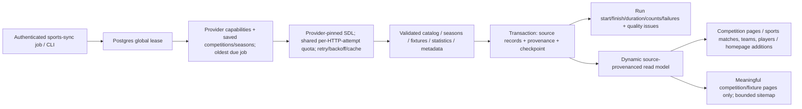

# Automatic discovery and synchronization — implementation and limits

**Branch:** arena/9d8e64d8-sport. **Status:** implemented and locally tested; not deployed, not merged, no production migration executed. **Live definition of done is NOT yet achieved**: production catalog authorization, durable infrastructure, scheduler cadence and provider responses remain unverified/unavailable in this sandbox. No global-completeness claim.

Read `AUTO_DISCOVERY_ARCHITECTURE.md` first: its diagram, endpoint/schema inventory and pre-change limitations were written before application modifications.

## Actual implemented flow

- New additive `sports_sync_*` tables hold source-local records. Existing canonical entities, admin records, legacy provider catalog and broadcast stores are **not rewritten**. New records have case-sensitive opaque source keys and deterministic UUIDs, immutable human-readable slugs, original and normalized UTC kickoff, source/provider ID, first/last seen, last successful observation, availability and per-field provenance. Verified legacy `provider_entity_map` IDs are retained as `canonicalId` when available; no new fuzzy canonical links are manufactured. Source-local read-model IDs are distinct from old canonical table IDs unless an explicit verified mapping exists.
- Catalog asks **each** registered catalog-capable source independently for its declared sports. The legacy catalog discovery also now pins providers rather than stopping at the first successful fallback. No popular-competition allowlist restricts the new job. Football-Data scoped fixture/standings calls accept new provider codes/IDs; the provider—not a handwritten list—decides permission.
- Catalog response storage resumes in 50-row chunks. Missing rows from a completed nonempty scope become `unconfirmed`; they are never deleted/deactivated. Empty/stale/error responses preserve the old catalog and record failure. Shrink >30% records an actionable review issue.
- Football-Data competition detail yields season IDs, current-season marker, original start/end dates and **separate** documented season query value (starting year). Historical/current seasons are preserved. TheSportsDB season-name IDs are retained when no numeric ID is supplied; current season is not guessed from the calendar.
- Upcoming: yesterday through next 30 UTC days. Results: previous 7 days through today. Backfill: discovered season dates, at most 730 days per season, 1–7-day windows according to adapter capability. FD uses its documented exclusive `dateTo`; default adapter transport uses one exact UTC day. TheSportsDB unscoped day feed is fetched once per sport/date, not once per league. A season with unknown dates is not given fabricated dates.
- Optional `syncFixturePage` contract resumes an opaque provider cursor. FD's documented bounded-date matches response has no invented pagination. Generic pagination is tested across pages/windows; default transports flag >=200 rows as potentially truncated. Repeated source IDs deduplicate overlapping windows. Cursor loops/100-page caps, >500-row pages, invalid relationships/timestamps/scores and schema changes are recorded, not silently called complete.
- Live uses source live feeds and can **observe** additional competitions from real named fixtures. This is clearly labeled `observed_fixture`, not a complete competition catalog. No fixture is imported without real competition/team identity and a valid timezone-aware timestamp.
- Scores/status/venue/kickoff and supplied details are refreshed. A verified stored final is never downgraded or overwritten by a conflicting score; review issues retain evidence. Similar cross-source names never auto-merge. Potential overlapping fixture observations are preserved separately for review. Exact verified legacy mappings are preferred, but this release does not perform new automatic cross-provider entity merges or arbitrary conflict arbitration.
- Statistics run only with supported methods and a verified current-season query value; standings/scorers are keyed by competition **and** season. FD checks response competition/year consistency. Empty/invalid tables do not replace last-good tables. Team identities/names are derived only from actual fixture/table rows; player identities from actual scorers. Supported team/player profile methods refresh periodically, not on every fixture pass. Existing request-time player-statistics/events/lineups integrations remain intact; the new read-only match pages do not promise telemetry or broadcast.

## Jobs, quotas and scheduling

`GET /api/cron/sports-sync/{catalog|seasons|upcoming|live|results|statistics|metadata|backfill|quality|tick|status}`. Same existing secret names (`CRON_SECRET`, `NEMO_INGEST_TOKEN`, `VERCEL_CRON_SECRET`), bearer or query token. Prefer bearer to avoid URL logs. Missing secret ->503, invalid ->401. No credentials reach client bundles.

Desired minimum cadence (not guaranteed hosting execution): catalog/seasons daily; upcoming hourly; live 60s (FD free scores may be delayed); recent results 15min; statistics 6h; metadata weekly; backfill hourly; quality daily. Default batch processes at most two task/pages, begins no new task after its time budget, checks write deadlines, and persists checkpoints atomically. Runs distinguish successful **batches** from complete sweeps (`checkpoint != null` means more work). Counters include entity-level fixture counts as well as total record writes, so inferred team writes cannot be mistaken for inserted fixtures.

- Global Postgres lease excludes concurrent synchronization. Each write transaction locks/verifies the lease owner; after worker interruption a five-minute lease expires and stale running history becomes failed with an actionable recovery message. Jobs do not delete history or clear tables. Data + checkpoint commit or roll back together. Failed scopes advance for fairness and are retried on subsequent sweeps, not abandoned permanently.
- Actual BaseAdapter HTTP attempts—including errors, retries and internal pages—now reserve quota before calling fetch. Memory reservations are atomic within one process; Redis uses one Lua all-or-none reservation across quota windows. Redis quota failure is fail-closed, even though ordinary cache reads remain best-effort. Retries use bounded exponential backoff; auth/429 are not blindly retried. Redis initialization now waits for connection before the first health probe.
- Production **new synchronization** refuses process-memory quota budgets: healthy configured Redis and Postgres are required. These are existing dependencies and can be self-hosted/free; no paid service was added. Redis Lua requires an appropriate Redis deployment (multi-key reservation should be checked for Redis Cluster hash-slot constraints).
- `tick` selects oldest due work to avoid live-job starvation of catalog/backfill. For dependable live freshness use a dedicated `live` caller plus a separately frequent batching caller. A single once-per-minute tick across many provider/sport scopes does NOT guarantee a one-minute refresh for every sport.
- `vercel.json`, CI deployment settings and existing cron schedules remain **byte-for-byte unchanged**. Existing daily/weekly invocations cannot drain a large catalog or guarantee live persistence. The new routes/CLI are not silently activated in production. After approval, an existing authorized scheduler, free self-hosted worker or local machine can call these routes/`npm run sports-sync -- tick` frequently and drain checkpoints. An external scheduled caller must check run/state/SQL counts, not just HTTP 200. No GitHub Actions/Vercel deployment or paid scheduler was created.

## Provider coverage: what is known vs blocked

| Source | Implemented automatic capability | Limits / confirmation boundary |
|---|---|---|
| Football-Data.org | `/competitions` catalog; competition detail seasons/current marker; scoped matches in date windows; standings/scorers/teams | Existing v4 interfaces plus tested normalization. Visibility in catalog is **not entitlement**. 403 plan restrictions remain authoritative. Free plan commonly advertises 12 competitions/10 calls per minute; internal budget defaults to 8. Actual key-specific coverage and new counts are unverified here. |
| TheSportsDB | Sport-filter league catalog; season listing; unscoped day events; team/player metadata | Uses adapter's declared sports, not a verified complete sport catalog. Artwork/catalog membership does not prove fixtures/live/standings. No current-season/date-range metadata is invented. Free/community access may limit event rows; suspected truncation fails visibly. |
| SportScore | Observations from live/day feeds; existing fixture/standings/scorers/player integrations | No verified catalog or season-enumeration interface in checkout. Observed coverage is not exhaustive; no full-season completeness claim. Existing audit has captured Egyptian responses, **not new live evidence**. |
| API-Football / Sportmonks / Sportradar | Registered only with existing credentials; existing declared integrations preserved | This checkout lacks verified catalog methods for these adapters. No guessed list endpoints or new paid sources were added. Some legacy methods aggregate pages internally; Sportmonks no longer returns incomplete page sequences as a successful complete response. These adapters need credentialed documentation/pagination validation before promising one-HTTP-page resumability under Vercel's 60s limit. Schema/identity errors are rejected/recorded rather than fabricated. |
| Demo / licensed HTML pipeline sources | Not used as an automatic discovery source | Demo never enters durable sync. Existing licence/robots/permission switches untouched. |

Official documentation links for operator validation: Football-Data [v4](https://docs.football-data.org/general/v4/index.html), [quickstart](https://www.football-data.org/documentation/quickstart); TheSportsDB [API](https://www.thesportsdb.com/api.php). This environment cannot fetch those hosts; **links and local schema tests are not new live provider verification**.

## Frontend and SEO

- Existing pages/URLs/visual identity are preserved, with additional dynamic directory sections on competitions, homepage, fixtures, results, teams and players. `/sports` supplies sport-filtered upcoming/live/completed/teams/players views.
- New stable `/competitions/{name--uuid}` pages show discovered seasons, known schedules, teams and verified current-season tables/scorers. Existing curated URLs (e.g. `/competitions/egyptian-league`) retain precedence and are not renamed.
- New `/sports/matches/{home-vs-away--uuid}`, `/sports/teams/{name--uuid}`, `/sports/players/{name--uuid}` are **read-only data pages**, not replacements for existing match/broadcast pages. Every imported fixture links to its source-correct competition/team pages. This deliberate namespace prevents accidental interception of stream/provider/admin URLs.
- Cairo grouping/display, stale timestamps, unavailable/no-data wording, RTL and responsive grids/tables are used. A catalog-only competition is not advertised as fully populated. New player/team shells remain noindex. Unknown new detail URLs actually answer 404; an initial loading-boundary test caught streamed 200-on-notFound and was corrected before completion.
- Sitemaps include at most 1,000 meaningful synchronized competition/fixture pages, retaining data during upstream outages. Legacy curated competitions now require actual fixture evidence instead of a site-wide healthy-feed assumption. Internal filters use canonical/noindex utility pages. Sitemap/robots were fetched directly from a **local production build**, not the live site. No ranking/indexing guarantee.

## Tests and evidence

Local files: `docs/verification-auto-discovery/{check.log,build.log,http.log,audit.json}`. Final commands and exit codes documented in the completion report.

- 21 new tests cover new competition/season discovery, both providers independently, multi-page/window checkpoints, idempotency, duplicate prevention, historical/final protection, empty/error/shrinking catalogs, timeouts/backoff/quota exhaustion, two-source conflict review, Cairo DST/winter midnight, season/statistics consistency, canonical URLs, missing/stale RTL components, transactional rollback, disk-backed SQL persistence after close/reopen, distributed lease/cadence, 50-record catalog batches, quality errors and immutable safety checks.
- PGlite is a **dev-only PostgreSQL-compatible embedded test database**, not a production replacement or new service. Test writes execute the actual migration/upsert/checkpoint/run SQL, then reopen disk storage. This is stronger than an in-memory fake but is not a production Postgres/Vercel execution test.
- Fixture test counts: initial live batch fetched **1**, inserted **1 fixture + 2 teams**; identical repeat fetched **1**, inserted **0 fixtures**, updated **1 fixture + 2 teams**, total fixture count **1**. Multi-page/window test makes **4** fixture page calls containing duplicated IDs; only **1** source fixture remains. Durable SQL case stores **1 competition, 1 season, 1 fixture, 2 teams**, persists run completion, reopens and reads **1 fixture**. These are synthetic isolated test responses, never production/demo replacements.
- Existing SDL suite: 177 tests pass. Full original check suite + new tests + lint and production build pass. Legacy HTTP smoke checks 37 routes plus additional new HTTP cases. A 16-file SHA-256 baseline asserts broadcast/player/source stores, auth, schema and deployment configuration match the original commit byte-for-byte.

## Specific remaining blockers / intentionally conservative gaps

1. No provider keys, DB/Redis credentials, production dashboard or provider-host/live-site network access exists in this sandbox. **New competitions discovered from real responses: not measured (no new live requests possible)**. Do not infer zero provider coverage.
2. Production migration 0007 and approval of a frequent scheduler are required. No production scheduler invocation/persisted SQL update has been verified; live production availability/freshness is unknown.
3. Full provider sport catalogs and catalog methods for three existing paid adapters require verified documentation/permissions. Unsupported scopes are reported; no universal/global completeness claim. Existing adapter sport declarations remain the discovered scope where a full sport catalog is unverified.
4. Legacy internally paginated adapters can exceed one-request timing assumptions. Host termination records unfinished work for later recovery, but complete one-page resumability must be added/verified for those providers before enabling large authorized scopes. Local tests validate the generic page contract and FD day windows, not every remote provider plan.
5. The read/plan safety cap is 50,000 source records (explicit actionable error, never silent truncation), fixture page cap 500, season window cap 730 days, public directory 300 rows, sitemap 1,000. Partitioned database pagination/public pagination is necessary before production coverage reaches that scale. New records are expandable without league code edits within these documented technical limits.
6. Uncertain cross-source records remain separate, with review issues; no speculative deduplication/score arbitration. Exact legacy mappings are reused, but a fully unified new canonical-table writer and automatic verified cross-source alias consolidation are not enabled. This is an additive read model, not a replacement of the old schema.
7. New match pages intentionally do not include broadcast, events/lineups or a player-statistics warehouse. Existing authorized request-time telemetry integrations are preserved; unavailable season/current metadata means new statistics jobs skip rather than guess.
8. Redis Lua reservation is tested through the shared memory quota contract and source inspection; no live Redis server/Cluster is available here. Redis integration and provider quota headers require staging verification. Mobile grids/RTL and server-rendered states are tested/inspected, not a full real-browser visual audit.

## Approval-only rollout (not performed)

1. Review changes, back up the existing database; apply **only additive migration 0007** to the existing approved database (do not reset/seed historical or stream tables).
2. Verify existing provider credentials/authorization and a healthy Redis connection server-side. Do not put keys in chat, public environment names or browser URLs.
3. Invoke a catalog batch with existing secret; inspect `status`, `entities`, cursor, run history and database records. Drain catalog and seasons, then upcoming/results/backfill. Validate key-specific coverage and rights.
4. Approve frequent external/self-hosted scheduling (or an existing plan-supported scheduler); verify live cadence, checkpoint progress, last success and partial-failure alerts with actual SQL counts. Old daily cron alone is insufficient.
5. Verify production canonical pages, Cairo date boundaries, robots/sitemap, source permissions and unchanged broadcast behavior. Only then describe production synchronization as active.
